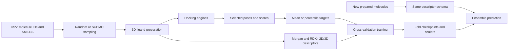

# Machine Learning Surrogate Models for Rapid Consensus Docking

This project builds molecular surrogate models for consensus docking scores. It compares random and SUBMO diversity sampling, prepares 3D ligands, runs docking engines, constructs molecule-aligned targets, and trains descriptor MLP ensembles. Once trained, the ensembles score new molecules from Morgan fingerprints and RDKit descriptors without rerunning docking.

The current molecular study uses the AmpC screening dataset. All paths, model locations and pocket coordinates are supplied through script arguments.

## Workflow



Docking produces the labels for training. Prediction uses the prepared structures, descriptors, and saved models.

## Repository layout

```text
Sampling/                         Random reservoir and SUBMO sampling
Ligand_Preparation/                CSV to optimized 3D SDF and optional MOL2
Docking/                          GNINA, LeDock, DiffDockHPC and rDock wrappers
Consensus_Target_Construction/    Pose/score extraction and configurable targets
Model_and_Training/
  Descriptor_Generation/          generate_descriptors.py and feature_names.csv
  Training/                       Two trainers, shared model utilities and configs
  Models/                         Saved MBE and percentile-consensus ensembles
  Prediction/                     Unified ensemble predictor
examples/molecules.csv            Ten ZINC rows from the project's AmpC sampling table
tests/                            Regression tests and a portable workflow smoke test
```

The example table retains the original ZINC IDs, SMILES and `dockscore` values. Its `dockscore` column supplies the existing DOCK3.7 scores.

## Included trained models

Both ensembles use 2274 features in the exact order listed in [feature_names.csv](Model_and_Training/Descriptor_Generation/feature_names.csv): 217 RDKit 2D descriptors, 2048 Morgan radius-2 bits, and nine RDKit 3D descriptors.

| Model | Training target | Architecture | Checkpoint selection |
| --- | --- | --- | --- |
| [MBE](Model_and_Training/Models/mbe/) | `(GNINA minimizedAffinity + LeDock score) / 2` | BatchNorm MLP; 2048/1024/512 hidden layers, SiLU | Lowest validation MSE |
| [Percentile consensus](Model_and_Training/Models/percentile_consensus/) | Mean mid-rank percentile of GNINA, LeDock and DOCK3.7 on their complete intersection | LayerNorm MLP; 1024/512/256/128 hidden layers, ReLU | Highest validation top-1% NDCG |

Each ensemble contains ten fold checkpoints and the corresponding feature/target scalers. Lower target values and predictions rank better. Model directories contain their configuration, feature schema, evaluation summaries and a SHA-256 file manifest.

The target builders also support new engine combinations. Train a corresponding new model when choosing a new target definition. The packaged percentile checkpoint represents the three-engine definition above.

## Environment and external files

The core scripts were checked with Python 3.9, RDKit 2025.03.5, NumPy 2.0.2 and PyTorch 2.5.1.

```bash
conda create -n consensus_surrogate python=3.9 pip -y
conda activate consensus_surrogate
python -m pip install torch==2.5.1 --index-url https://download.pytorch.org/whl/cpu
python -m pip install -r requirements.txt
```

For CUDA training/prediction, install the PyTorch build matching the CUDA host. The descriptor/target scripts do not require GPU inference. Open Babel is required only for MOL2 conversion:

```bash
conda install -c conda-forge openbabel
```

External components are installed separately:

| Component | Source | Files used here |
| --- | --- | --- |
| SUBMO | [Original implementation](https://github.com/tomotomonakanaka/SUBMO) | `model/gnn_models.py` on `PYTHONPATH`, plus a trained full-model QM9 checkpoint passed with `--model` |
| GNINA | [GNINA repository](https://github.com/gnina/gnina) | Executable supplied with `--gnina`; optional container image |
| LeDock | [LePhar download](https://www.lephar.com/download) | `ledock` executable; a prepared receptor such as LePro's `pro.pdb` |
| DiffDockHPC | [DiffDockHPC repository](https://github.com/Jnelen/DiffDockHPC) | Inference source, YAML, local score/confidence checkpoints and matching receptor ESM embedding |
| rDock | [rDock documentation](https://rdock.github.io/) | Installation with `bin/`, `lib/`, `data/`; prepared receptor PRM and matching `.as` cavity |

SUBMO sampling additionally uses `dgl==1.1.3` and `dgllife==0.3.2` in the tested CPU environment. The upstream SUBMO README provides training instructions but no direct pretrained-checkpoint download link. Supply an available QM9 checkpoint or obtain one from the authors; its path is independent of the surrogate model directories.

Full docking requires each engine's receptor and installation. GNINA and LeDock use a specified binding box. DiffDockHPC performs whole-protein inference; its postprocessor filters poses by distance to a supplied pocket center. Receptor structures and all compared poses must use the same coordinate frame.

## Input and alignment conventions

- Sampling CSVs have a header. Ligand preparation expects `zincid` and `smiles`, with unique IDs in `ZINC` followed by digits format.
- Docking wrappers expect one prepared molecule per input file and unique filename stems throughout a batch.
- Preprocessors output one selected SDF per molecule and a headerless six-column table: `score;rank;software;pose_index;molecule_id;pose_path`.
- Target builders join scores by normalized molecule ID and require a finite score from every selected engine. Identical duplicate scores collapse; conflicting duplicate scores are reported as errors.
- Descriptors retain supplied 3D conformers and explicit hydrogens. No additional conformer optimization or scaling is performed during descriptor generation.
- `zinc_ids_aligned.csv` fixes matrix row order. `feature_names.csv` fixes column order. Training aligns targets by ID; prediction checks the feature schema and row counts.

All commands below run from the repository root. Replace `/path/to/...` with local input paths and select a new output path for each run.

## 1. Sampling

Random sampling uses a streaming reservoir with a fixed seed:

```bash
python Sampling/random_sampling.py \
  --input /path/to/AmpC_screen_table.csv.gz \
  --output work/random.csv --n-select 500000 --seed 42
```

SUBMO sampling uses the QM9 GNN representation and global greedy maximization of `log det(I + X_S X_S^T)`:

```bash
export PYTHONPATH="/path/to/SUBMO${PYTHONPATH:+:$PYTHONPATH}"
python Sampling/submo_diverse_sampling.py \
  --input /path/to/AmpC_screen_table.csv.gz --smiles-col smiles \
  --model /path/to/qm9_attentivefp_model.p \
  --output-dir work/diverse --n-select 500000 --workers 8 --device cpu
```

Its outputs include all valid embeddings, aligned metadata, selected CSV and selected embeddings. Graph construction and candidate scoring are parallel; greedy choices are sequential and global. Exact selection cost grows with dataset size and requested subset size. See [Sampling documentation](Sampling/README.md) for setup and options.

## 2. Ligand preparation

```bash
python Ligand_Preparation/prepare_ligands.py \
  --input work/random.csv --output-dir work/ligands \
  --workers 8 --seed 42 --mol2
```

For diverse sampling, use `work/diverse/selected.csv`. Preparation adds hydrogens, generates an ETKDGv3 conformer, and runs up to 1000 MMFF optimization iterations, with UFF when MMFF parameters are unavailable. Only converged, validated molecules are retained. Failed preparations are recorded and their partial files removed. `--mol2` additionally uses Open Babel for LeDock inputs.

Outputs include `sdf/`, optional `mol2/`, successful-ligand path lists, a per-molecule report and a summary.

## 3. Docking

GNINA example:

```bash
python Docking/gnina_batch.py \
  --gnina /path/to/gnina --receptor /path/to/receptor.pdb \
  --ligands work/ligands/sdf --output work/gnina \
  --center 23.176 5.742 13.697 --size 20 20 20 \
  --jobs 4 --cpus-per-job 2
```

LeDock example:

```bash
python Docking/ledock_batch.py \
  --ledock /path/to/ledock --receptor /path/to/pro.pdb \
  --ligands work/ligands/mol2 --output work/ledock \
  --center 23.176 5.742 13.697 --size 20 20 20 --jobs 8
```

The example center is the project's AmpC setting. Set the center and dimensions for the receptor used in the run. See [Docking documentation](Docking/README.md) for DiffDockHPC inputs, rDock preparation, container execution and Slurm examples. The wrappers record commands, completion status, logs and run configurations.

## 4. Pose and score preprocessing

GNINA selects the lowest finite `minimizedAffinity` and its exact readable pose. It accepts both batch output and historical MetaScreener layout:

```bash
python Consensus_Target_Construction/preprocess_gnina.py \
  --base-dir work/gnina --output-dir work/gnina_preprocessed
```

LeDock selects the lowest-scoring DOK cluster and rebuilds SDF chemistry using a template from the same ligand preparation workflow:

```bash
python Consensus_Target_Construction/preprocess_ledock.py \
  --base-dir work/ledock --template-dir work/ligands/sdf \
  --output-dir work/ledock_preprocessed
```

Template/DOK atom correspondence is checked in full-atom or heavy-atom element order. Preserve the original ligand atom order through SDF-to-MOL2 conversion. An optional GNINA template directory checks chemistry; `--require-gnina-match` requires that check to pass. Existing `--dd-template-dir` usage remains supported.

Optional engines:

```bash
python Consensus_Target_Construction/preprocess_rdock.py \
  --base-dir work/rdock --output-dir work/rdock_preprocessed

python Consensus_Target_Construction/preprocess_diffdock.py \
  --base-dir work/diffdock --output-dir work/diffdock_preprocessed \
  --pocket-center 23.176 5.742 13.697 --distance-threshold 20
```

rDock selects the lowest native `SCORE`, preserving the original SD record index. DiffDock checks rank 1, then rank 2 and subsequent ranks, retaining the first usable pose within the centroid distance threshold with finite confidence above -999. Failed batch jobs and molecules without qualifying poses are recorded as exclusions.

## 5. Descriptors and targets

Generate the trained feature schema from the prepared structures:

```bash
python Model_and_Training/Descriptor_Generation/generate_descriptors.py \
  --input work/ligands/sdf --output-dir work/descriptors \
  --workers 8 --batch-size 128
```

Outputs are `X_features.npy`, `zinc_ids_aligned.csv`, `feature_names.csv`, exclusion and descriptor-failure tables, and a generation summary. Calculation uses bounded batches and a memory-mapped output. Descriptor exceptions/nonfinite values are replaced with zero using the training policy. `--exclude-ids` optionally removes training molecules when preparing a screening library.

MBE target:

```bash
python Consensus_Target_Construction/build_mean_binding_energy_target.py \
  --engine gnina=work/gnina_preprocessed/csvs/Results_scoring.csv \
  --engine ledock=work/ledock_preprocessed/csvs/Results_scoring.csv \
  --ids-csv work/descriptors/zinc_ids_aligned.csv \
  --output-dir work/targets/mbe
```

Three-engine percentile target matching the packaged model's engine definition:

```bash
python Consensus_Target_Construction/build_percentile_consensus_target.py \
  --engine gnina=work/gnina_preprocessed/csvs/Results_scoring.csv \
  --engine ledock=work/ledock_preprocessed/csvs/Results_scoring.csv \
  --engine dock37=/path/to/ampc_sampled_dataset.csv \
  --ids-csv work/descriptors/zinc_ids_aligned.csv \
  --output-dir work/targets/percentile
```

The DOCK3.7 CSV uses `zincid` and `dockscore` by default. Engine choices are configurable by repeating `--engine NAME=PATH`. Custom header CSVs also accept `--engine-format NAME=csv`, `--engine-id-column`, `--engine-score-column`, `--engine-sep` and `--engine-direction NAME=lower|higher`.

For percentile consensus, each engine's average tie rank becomes `(rank - 0.5) / N` on the complete selected-engine intersection; the primary target is the mean across engines. Lower scores rank first for energy engines; higher confidence ranks first for DiffDock. Mean-score targets negate higher-is-better scores before averaging. Every run saves its engine set, directions and formulas in `summary.json`. Aligned arrays retain NaN for descriptor IDs without a complete target.

## 6. Training

```bash
python Model_and_Training/Training/train_mbe.py \
  --descriptor-dir work/descriptors --targets work/targets/mbe/y_mbe.npy \
  --output-dir results/mbe

python Model_and_Training/Training/train_percentile_consensus.py \
  --descriptor-dir work/descriptors \
  --targets work/targets/percentile/y_percentile_consensus.npy \
  --output-dir results/percentile
```

Defaults use the final hyperparameters in `Training/configs/`. Both trainers fit feature and target scalers using each training fold only and export checkpoint/scaler pairs, the feature schema, validation fold assignments, OOF predictions and metrics. The new target's engine recipe is copied into the saved model configuration. See [Training documentation](Model_and_Training/Training/README.md) for architecture and execution controls.

## 7. Prediction with saved models

Generate descriptors for new prepared molecules using the same feature schema, then run:

```bash
python Model_and_Training/Prediction/predict.py \
  --descriptor-dir /path/to/new_descriptors \
  --model-dir Model_and_Training/Models/mbe \
  --output results/mbe_predictions.csv

python Model_and_Training/Prediction/predict.py \
  --descriptor-dir /path/to/new_descriptors \
  --model-dir Model_and_Training/Models/percentile_consensus \
  --output results/percentile_predictions.csv
```

The predictor applies each fold's saved feature scaler, loads its model, reverses target scaling and averages predictions. The CSV includes original row IDs, mean prediction, population standard deviation across folds and ascending prediction rank. `--sort` sorts the output; `--save-fold-predictions` saves an N-by-fold matrix in original descriptor order. `--device cpu` forces CPU inference. See [Prediction documentation](Model_and_Training/Prediction/README.md).

## References

- [SubMo-GNN source](https://github.com/tomotomonakanaka/SUBMO) and [paper](https://www.nature.com/articles/s41598-022-04967-9).
- [RDKit](https://www.rdkit.org/) for molecular structures, descriptors and Morgan fingerprints.
- [GNINA](https://github.com/gnina/gnina), [LeDock](https://www.lephar.com/), [DiffDockHPC](https://github.com/Jnelen/DiffDockHPC), [DiffDock](https://github.com/gcorso/DiffDock) and [rDock](https://rdock.github.io/) for docking.

Upstream software retains its original licenses. Download and use its source, checkpoints and binaries according to the corresponding project terms.
